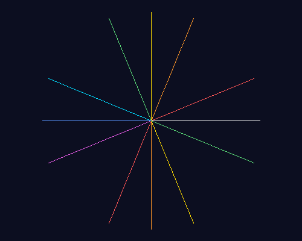
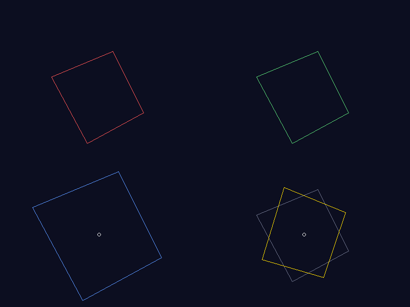
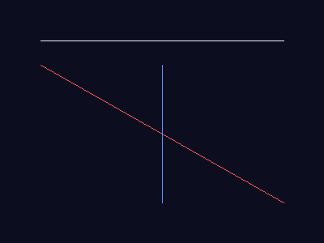
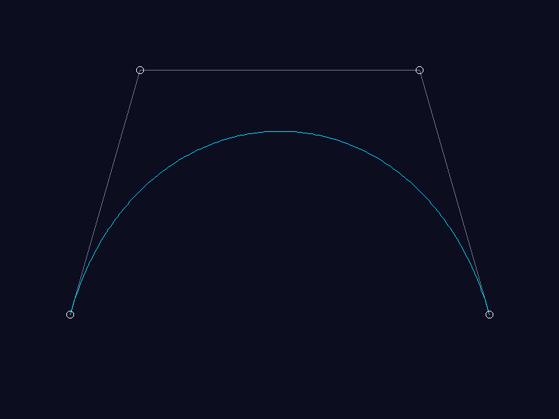
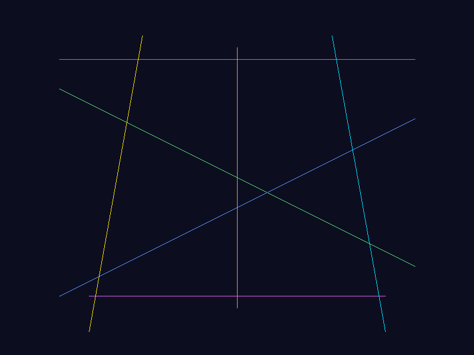
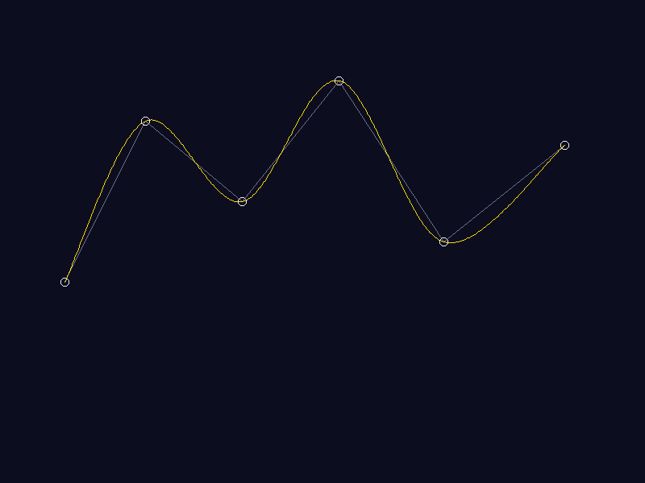
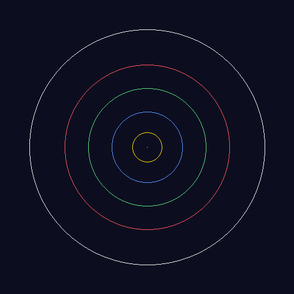
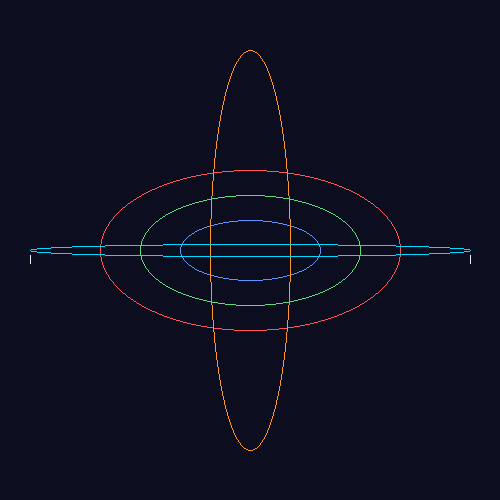
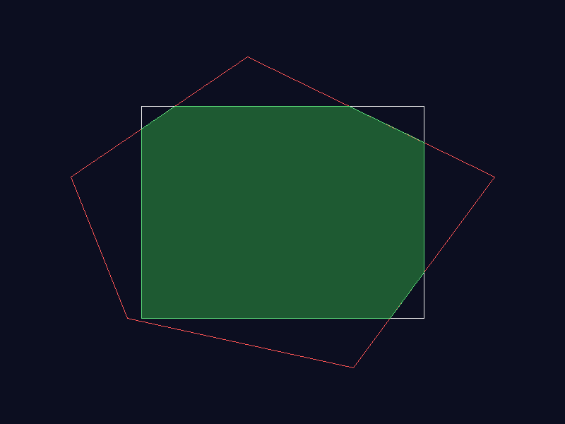
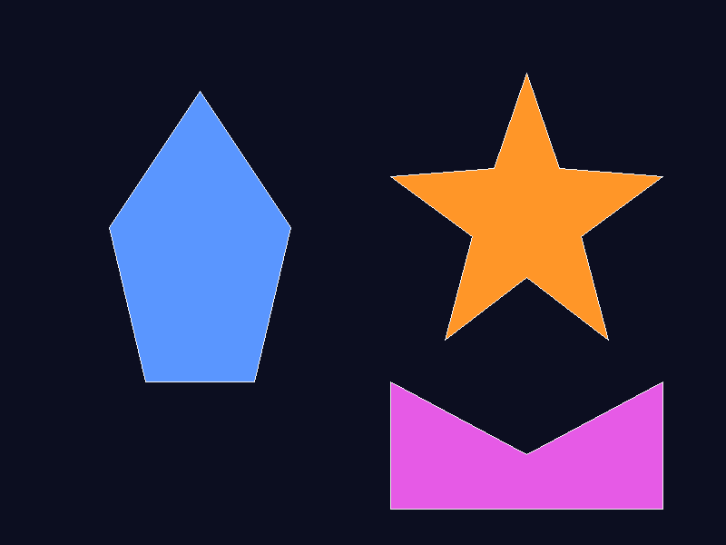

# Project Stellar: Solar System

## 1. Project Description

Project Stellar is a C++ computer graphics project focused on implementing fundamental raster graphics algorithms and applying them to a Solar System visualization.

The project implements graphics techniques for drawing lines, representing and manipulating polygons, clipping and filling shapes, drawing circles and ellipses, and generating curves. These algorithms form the foundation for rendering objects and orbital paths in the Solar System scene.

The current version uses pure C++ and a custom raster canvas to generate graphics output as BMP images. The project is being developed incrementally, starting with the core graphics algorithms before expanding the Solar System visualization.

## 2. Group Members and Responsibilities

| Group Member | Registration Number | Responsibility |
|---|---|---|
| Rabadiya Vinit Manishkumar | 149227 | Core rendering and orbit mathematics |
| Wafula Mornylyne Mutilah | 164534 | Core rendering and orbit mathematics support |
| Odhiambo Eugene Onyango | 166333 | Camera and navigation controls |
| Patel Radha Saileshkumar | 149226 | Scene design, colours, object sizes, and lighting |
| Tavasi Wyclef Wasike | 166082 | Testing and integration |
| Wanjiku Esther Jesicah | 166232 | Documentation, repository management, and presentation |

## 3. Technologies and Tools

The project currently uses the following technologies and development tools:

- **C++17:** Main programming language used to implement the graphics algorithms.
- **GCC/G++:** Compiler used to compile the C++ source files.
- **CMake:** Build system used to configure and build the project.
- **Visual Studio Code:** Development environment used to write and manage source code.
- **Git:** Version control for tracking changes.
- **GitHub:** Repository hosting and collaboration through branches and pull requests.
- **PowerShell:** Terminal used for project commands and compilation.
- **Custom RasterCanvas:** A raster drawing component used to generate graphics and save the output as BMP images.

## 4. Graphics Techniques and Algorithms Implemented

The following graphics algorithms have been implemented in the current project.

### 4.1 Line Drawing Algorithms

- **Digital Differential Analyzer (DDA):** Draws a line by calculating intermediate points between two endpoints.
- **Bresenham's Line Drawing Algorithm:** Uses integer-based calculations to determine the pixels used to draw a line.

### 4.2 Polygon Representation and Operations

- **Polygon Representation and Operations:** Represents polygons using vertices and supports basic polygon operations.

### 4.3 Polygon Clipping

- **Sutherland–Hodgman Polygon Clipping:** Clips a polygon against a clipping boundary to determine the visible portion.

### 4.4 Polygon Filling

- **Scan-Line Polygon Filling:** Fills the interior of a polygon by processing horizontal scan lines.

### 4.5 Circle and Ellipse Drawing

- **Midpoint Circle Drawing Algorithm:** Uses midpoint calculations and symmetry to draw circles.
- **Midpoint Ellipse Drawing Algorithm:** Uses midpoint calculations to draw ellipses.

### 4.6 Curves and Splines

- **Cubic Bézier Curve:** Generates a smooth curve using four control points.
- **Catmull–Rom Spline:** Generates a smooth curve that passes through its specified control points.

## 5. Solar System Visualization

The project includes an initial Solar System graphics scene that applies raster drawing techniques to represent celestial objects and their visual elements.

The current visualization work includes:

- Drawing the Sun and planets.
- Representing orbital paths.
- Applying colours and different object sizes.
- Drawing additional visual elements, such as Saturn's rings and Sun rays.
- Generating graphics output using the project's raster canvas.

The Solar System visualization is still under development and will be expanded as the project progresses.

## 6. Graphics Output

Generated graphics are organized in the `output/` directory. The images below should be added after the corresponding algorithms or graphics tests have generated the BMP files.

### 6.1 Solar System Visualization


### 6.2 DDA Line Drawing



### 6.3 Polygon Operations



### 6.4 Raster Canvas Test



### 6.5 Bezier Curve



### 6.6 Bresenham Line Drawing



### 6.7 Catmull-Rom Spline



### 6.8 Circle Graphics Test



### 6.9 Ellipse Graphics Test



### 6.10 Polygon Clipping



### 6.11 Polygon Filling




**Note:** These image links will display correctly only when the corresponding image files exist in the `output/` directory and are committed to the GitHub repository. If an image has not been generated yet, add it when it becomes available.

## 7. Project Structure

The main project files are organized as follows:

```text
3D-Solar-Navigator/
├── .github/
│   └── workflows/
├── include/
│   ├── raster/
│   │   └── raster_canvas.h
│   ├── algorithms/
│   │   ├── geometry.h
│   │   ├── lines/
│   │   ├── polygons/
│   │   ├── shapes/
│   │   └── curves/
│   └── scene/
│       └── solar_system_scene.h
├── src/
│   ├── main.cpp
│   └── algorithms/
│       ├── lines/
│       │   ├── digital_differential_analyzer.cpp
│       │   └── bresenham_line_drawing.cpp
│       ├── polygons/
│       │   ├── polygon_representation_and_operations.cpp
│       │   ├── polygon_clipping.cpp
│       │   └── polygon_filling.cpp
│       ├── shapes/
│       │   ├── midpoint_circle_drawing.cpp
│       │   └── midpoint_ellipse_drawing.cpp
│       └── curves/
│           ├── bezier_curve.cpp
│           └── catmull_rom_spline.cpp
├── tests/
│   ├── support/
│   ├── unit/
│   ├── integration/
│   └── visual/
├── output/
├── docs/
│   └── TESTING.md
├── screenshots/
├── CMakeLists.txt
├── .gitignore
└── README.md
```

The structure shows the intended organization of the project. Some folders, such as `screenshots/`, may remain empty. Generated BMP images are stored in `output/`.

Each algorithm is implemented once, in a header under `include/algorithms/`. The demo programs in `src/algorithms/`, the tests and the Solar System scene all include those headers, so the tests check the same code the application uses.

## 8. How to Compile and Run the Current Version

### Prerequisites

Install the following tools:

- A C++17-compatible compiler, such as GCC/G++.
- CMake 3.20 or later.
- Git.

### Clone the Repository

```powershell
git clone https://github.com/WTavasi/3D-Solar-Navigator.git
cd 3D-Solar-Navigator
```

### Configure the Project

```powershell
cmake -S . -B build
```

### Build the Project

```powershell
cmake --build build
```

### Run an Algorithm

After a successful build, run an individual executable from PowerShell. For example:

```powershell
.\build\digital_differential_analyzer.exe
```

Other available algorithm executables include:

```powershell
.\build\bresenham_line_drawing.exe
.\build\polygon_representation_and_operations.exe
.\build\polygon_clipping.exe
.\build\polygon_filling.exe
.\build\midpoint_circle_drawing.exe
.\build\midpoint_ellipse_drawing.exe
.\build\bezier_curve.exe
.\build\catmull_rom_spline.exe
```

The main application executable can be launched with:

```powershell
.\build\stellar.exe
```

These commands assume the corresponding targets build successfully. The current `CMakeLists.txt` defines the algorithm executables and the `stellar` executable.

On macOS and Linux, run the same programs with `./build/<name>` instead of `.\build\<name>.exe`.

### Run the Tests and Generate the Graphics Output

After building, run all of the tests:

```powershell
ctest --test-dir build --output-on-failure
```

This runs the unit tests for every algorithm, the Solar System integration tests, and the visual tests. The visual tests also regenerate every image in `output/`, including `solar_system_output.bmp`.

See [docs/TESTING.md](docs/TESTING.md) for how the tests work, how to run a single test, and the full test report.

## 9. Current Progress

The project has completed the initial implementation of the core raster graphics algorithms.

Current progress includes:

- Implemented DDA and Bresenham line drawing.
- Implemented polygon representation and operations.
- Implemented Sutherland–Hodgman polygon clipping.
- Implemented scan-line polygon filling.
- Implemented midpoint circle and ellipse drawing.
- Implemented cubic Bézier curves and Catmull–Rom splines.
- Developed a custom raster canvas for graphics output.
- Established a CMake build configuration.
- Organized the source code into algorithm categories.
- Set up Git and GitHub for collaboration.
- Started the Solar System visualization.
- Added automated unit, integration and visual tests (96 test cases) that run on every pull request.

The next stages focus on improving the visualization, integrating the graphics components, testing the outputs, and extending the scene.

## 10. Known Limitations and Issues

- The project currently uses a custom raster canvas rather than a dedicated real-time 3D graphics engine.
- Graphics output is currently generated as BMP images.
- The Solar System visualization is an initial implementation and is not yet a complete interactive 3D simulation.
- Some planned features, including camera and navigation controls, may require further implementation and integration.
- The automated tests cover the 2D raster algorithms and scene. The planned 3D transformations, camera and animation will need tests of their own as they are added.
- Individual algorithms are built as separate executables, while the main application continues to develop.
- Generated output images must be committed to Git if they are to appear in the GitHub README.
- Some visual features may need refinement to improve the appearance and accuracy of the Solar System scene.

## 11. Conclusion

Project Stellar applies fundamental computer graphics algorithms using C++ and a custom raster canvas. The completed algorithms provide a foundation for drawing and manipulating graphical objects, while the initial Solar System visualization demonstrates how these techniques can be applied to a larger graphics project.

Development will continue through algorithm integration, testing, visualization improvements, and the implementation of additional Solar System features.
